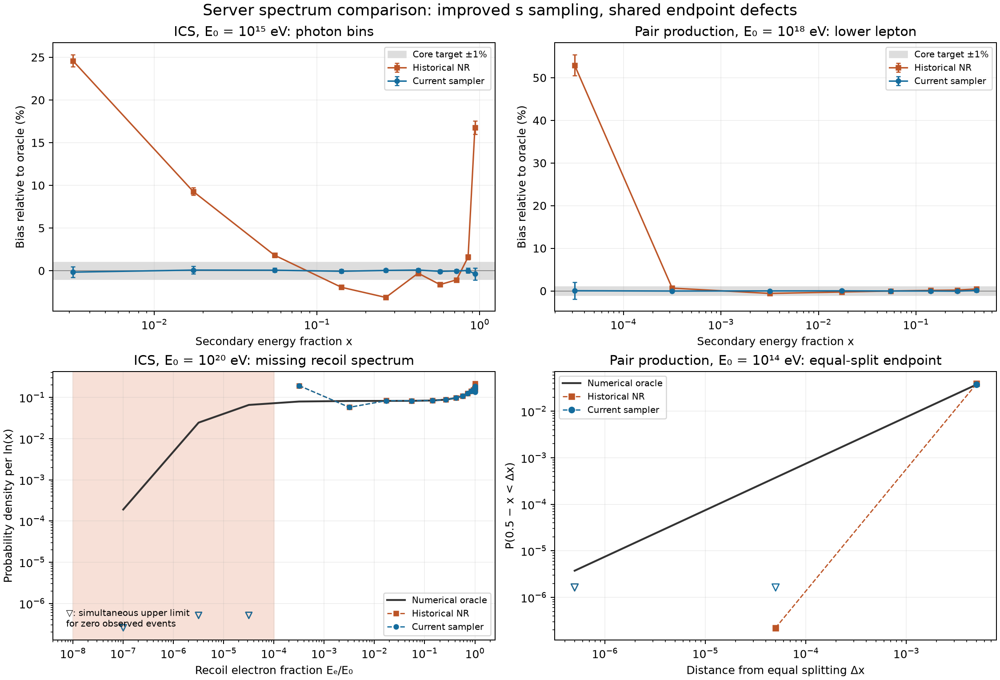

# Server PP/ICS secondary-spectrum results

Dedicated [ICS spectra for all six energies, formulas and primary sources](ics_secondary_spectra.md)
are available separately.

Reviewed on 2026-10-16. The replacement of the NR sampler substantially improves
secondary spectra, but the complete 1% core / 10% tail acceptance criteria are
**not satisfied**. The large remaining deviations are shared endpoint defects
in conditional secondary-energy inversion, exposed by the independent oracle.
Agreement between the two sampled implementations alone would miss them.

## Frozen run and integrity

Run: `em-secondary-20261012T070453-2242518`.

- Current physics commit: `cb5b2d9210846c6ba6b46ff2c4bb80ffb47b9751` (`talys`).
- Historical NR sampler: `d05723f449c1eecee4f00af392014df4c898ebe9`.
- NR headers: historical gitlink `0e6af5083b426ca9423bc6da60372eba49f6ab6c`.
- Server: Ubuntu 22.04, GCC 11.4, GSL 2.7.1, Boost 1.74; Python 3.10.12,
  NumPy 2.2.6, SciPy 1.15.3.
- Main sample: **801896280 interactions**, with equal historical/current
  counts in each case; 27017642--37543420 events per case and sampler.
  The additional 22000 pilot events are excluded from inference.
- Total runtime including compression: **39250.006 s = 10 h 54 min 10 s**;
  analysis completed after 37850.167 s. The 24-hour cap was respected.
- All 132 CTest and 12 then-frozen Python checks passed before main sampling.
  All planned chunks completed; the final exit code 2 means a material
  discrepancy, not an execution failure or timeout.

The complete compressed archive was read successfully. All manifest hashes
matched: 16486 file members, 8054 raw event files, no missing manifest paths,
checksum mismatches or invalid raw headers/record lengths. Raw records total
801918280 including pilots. Every completed chunk count table was reaggregated
and exactly matched the archived analysis input and planned event counts.
Reanalysis with the archived statistical adapter reproduced every precision
classification and every Holm significance decision. The local newer SciPy
changed adjusted p-values by at most 3.36e-10 in absolute value, with no
changes to decisions.

The first 100000-event chunk of each case/sampler was also decoded independently
(22 chunks, 2.2 million events). Rebinning reproduced every stored multiplicity
count. These fixed representative chunks are used below only to diagnose
endpoint structure; acceptance statistics use the full frozen ensembles.

The canonical raw artifact is the archive named above, supplied in the
adopted workspace's `mcray-test-data/` directory. Extracted metadata, integrity
checks, reanalysis and representative raw chunks are retained outside Git in
`validation/em-secondary-analysis-20261016/`. Public builds and server tests
do not require these private workspace paths.

## Scope and statistical interpretation

The [implemented contract](../../tests/sampling/SECONDARY_SERVER.md) defines
11 CMB-only single-interaction cases, 26 nonuniform energy-fraction bins,
extra cumulative/endpoint regions and correlated two-product multiplicities.
Only the s sampler is substituted. Both modes use the current cross sections,
background convolution and conditional secondary implementation; this is not
a full comparison of two executable revisions or a propagated cascade.

There are 12258 fixed category hypotheses, corrected together by Holm at
family-wise significance 1%. Simultaneous exact confidence intervals determine
whether the entire bias interval is inside 1% for core bins or 10% for tails.
Statistical significance and material deviation remain distinct. The oracle
integrates conditional differential laws directly; its convergence envelope is
an empirical numerical guard, not a certified error bound. All reported
material oracle discrepancies passed the implemented numerical guard.

| Comparison | Within target | Material deviation | Inconclusive |
| --- | ---: | ---: | ---: |
| Historical NR vs oracle | 918 | 214 | 230 |
| Current vs oracle | 1098 | 40 | 224 |
| Historical minus current | 876 | 158 | 328 |

These are observable regions, **not independent physical defects**: mirrored
products, charge views and overlapping tails repeat the same information.
There are 1362 regions per comparison, including 651 with rounded-zero
reference yield. Of the latter, 648 are support-proven forbidden regions and
three remain unresolved; zero observed events alone are not treated as proof.
Among the 711 positive-reference regions, current/oracle has 450 within-target,
40 material deviations and 221 inconclusive results.

For the **320 core regions**, historical NR has 196 within-target, 106 material
and 18 inconclusive; current has **304 within-target, 14 material and two
inconclusive**. All 14 current core discrepancies occur in high-energy ICS
at 1e18 or 1e20 eV. The two unresolved core regions are the same mirrored
ICS 1e15 eV photon/recoil bin: photon x in [0.9,0.97], simultaneous bias interval
[-1.0901%,+0.3375%], which narrowly crosses the unchanged 1% target.

Current has 26 material tail-region discrepancies and 222 inconclusive tails,
including two mirrored versions of each physical region. Full validation of
arbitrarily rare tails is therefore not established by this finite ensemble.
Holm-significant category tests number 700 historical/oracle, 100
current/oracle and 560 historical/current; these counts also include dependent
and complementary tests.

## Effect of replacing NR

Representative full-ensemble yield biases relative to the oracle are:

| Process and primary energy | Secondary region | Historical NR bias | Current bias |
| --- | --- | ---: | ---: |
| ICS, 1e15 eV | Photon x in [0.001,0.01] | +24.582% [23.885%,25.287%] | -0.165% [-0.790%,0.468%] |
| PP, 1e15 eV | Lower lepton x in [0.2,0.35] | -3.294% [-3.395%,-3.192%] | +0.0057% [-0.0963%,0.1080%] |
| PP, 1e18 eV | Lower lepton x < 1e-4 | +52.922% [50.550%,55.364%] | +0.044% [-1.873%,2.032%] |

Brackets are simultaneous confidence intervals, including the oracle envelope.
The current implementation meets the relevant target in all three examples;
the historical implementation materially fails it. Other thin historical
bins show order-unity relative errors. A small error in total rate or a global
CDF distance does not bound the relative error in a low-probability bin.



Top panels show selected binned biases (positive reference probability above
1e-4); the gray band is the 1% core target. Bottom-left shows bin-averaged
recoil density per ln(x), not a pointwise differential cross section.
Bottom-right shows cumulative equal-split regions. Downward open triangles
mark simultaneous upper limits for zero observations. Old/current curves
largely overlap in the two defective endpoint views. The plot is illustrative;
all acceptance decisions use the original full family, without selecting
bins after looking at the data.

## Shared ICS endpoint defect

At E0=1e20 eV, for recoil electron fraction y=Ee/E0 < 1e-4:

- Oracle probability: **0.2083956583**, predicting **7823885.7 events** per
  37543420-event ensemble.
- Observations: **zero in each mode**.
- Current relative bias interval: [-100.000017%, -99.999418%].

The missing events accumulate at larger recoil fractions. In y in
[1e-4,1e-3], current has a **+143.805%** bias, interval
[143.586%,144.024%]. In y in [1e-3,1e-2], the bias is **-29.895%**,
interval [-30.039%,-29.750%]. This is a gross distortion even though the
suppressed endpoint corresponds to very small electron energy.

The same structure already appears at E0=1e18 eV: y<1e-4 has oracle
probability 0.0014150946 and zero observations, while y in [1e-4,1e-3]
is overpopulated by **41.886%**, interval [41.589%,42.184%]. No material
current/oracle discrepancies were established for the tested ICS energies
1e13--1e16 eV; the two unresolved core regions noted above remain unresolved.

## Shared PP equal-split defect

For PP at E0=1e14 eV, the lower-lepton region **0.49995 < x < 0.5** has
oracle probability **0.0003741933302**. With 27017642 interactions the expected
count is **10109.8**. Current produces **zero**; historical NR produces **6**.
Current bias is -100%, interval [-100.000116%,-99.563311%].

The same endpoint region materially fails for current at all five tested PP
energies, including 1e20 eV (expected about 350 events, zero observed).
The still narrower region 0.4999995<x<0.5 is resolved as materially deficient
at 1e14 eV, but remains too poorly constrained at higher energies. Broad PP
core bins satisfy the current target; they conceal this narrow endpoint hole.

## Localization and sampler diagnostics

The archived
[ICS implementation](https://github.com/okolo/mcray/blob/cb5b2d9210846c6ba6b46ff2c4bb80ffb47b9751/src/lib/ICS.cpp#L57)
and
[PP implementation](https://github.com/okolo/mcray/blob/cb5b2d9210846c6ba6b46ff2c4bb80ffb47b9751/src/lib/GammaPP.cpp#L62)
set the secondary root solver's relative coordinate tolerance to **1e-3**.
[MathUtils](https://github.com/okolo/mcray/blob/cb5b2d9210846c6ba6b46ff2c4bb80ffb47b9751/src/lib/MathUtils.cpp#L581)
terminates bisection using `gsl_root_test_interval(x_lo,x_hi,0,relError)`.
This controls the sampled coordinate, not its distance from the upper
endpoint or the probability mass of a narrow endpoint region.

The subsequent [fixed-S code diagnosis](ics_endpoint_diagnosis.md) independently
reproduces this error and identifies a second ICS defect: the integral's
Taylor branch is selected by an absolute interval width, although its
expansion parameter is the interval divided by 1/S. It can produce normalized
integrals far above one and a nonmonotone function. Tightening the solver alone
therefore does not repair ICS sampling. Production sources remain unchanged.

The representative raw data provide a direct numerical signature. Let a,b be
the physical initial bounds of the solved photon fraction (ICS) or lower
lepton fraction (PP). The smallest normalized distance `(b-x)/(b-a)` is
**1/2048 = 0.00048828125** in every case/mode. At ICS 1e20 eV, exactly this
last bisection position contains **44561 of 100000 current** events and
44844 historical events. Current minimum recoil fraction is 0.0004885301
in that representative chunk, despite physically allowed much lower values.
Since b depends on s these positions form a pileup rather than one identical
marginal energy value. PP representatives exhibit the same normalized endpoint
gap. This identifies inadequate conditional inverse-CDF resolution as the
cause of the shared cutoff/pileup; changing the s sampler does not remove it.

Across the full main run there were **zero range-narrowing recursions and zero
argmax returns** in the current rejection sampler. All recorded support
residuals are zero; maximum relative energy-sum residual is 2.22e-16.
Conservation and support checks alone therefore do not detect the spectral
endpoint problem.

The rejection envelope is not strictly conservative: sampled PDF values
occasionally exceed the precomputed maximum. The largest recorded ratio is
**1.007378351**, in PP 1e18 eV; 3430219 of 37393712 events in that case record
an exceedance. This is distinct from the much larger shared conditional-energy
inversion defect. It remains a numerical limitation to audit, especially for
unresolved rare tails; broad-bin agreement is not proof of a globally valid
envelope.

## Reproduction and scope of the conclusion

Extract the metadata from the supplied archive and run its own saved adapter:

```sh
python adapter/analyze_secondary.py analysis-input.json report-repeated.json
```

The optional plotting tool requires Matplotlib and NumPy:

```sh
python tests/sampling/plot_secondary_report.py \
  --report /path/to/extracted/report.json \
  --reference /path/to/extracted/frozen-reference.json \
  --output /path/to/figures/em_sampling_server_20261012
```

The full results are `report.json`, `report.tsv`, the frozen reference/plan,
per-chunk count tables, raw event records and diagnostic headers. Preserve
those inputs and the original archive for later fixes and comparisons.
No production physics or sampling implementation was changed during this
review. The appropriate next correction concerns conditional inverse-CDF
accuracy at both endpoints, followed by fixed-s diagnostics and repetition
of the frozen comparison. A new propagated-cascade accuracy claim requires
its own calculation after the single-interaction defects are resolved.
